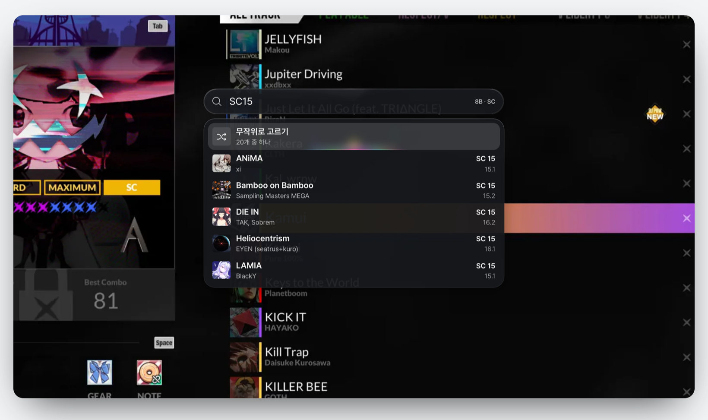

# DM PICKER

찾는 곡으로 바로 이동하는 곡 검색기

[](https://github.com/eun-yeon/DmPicker/releases)
[](https://github.com/eun-yeon/DmPicker/releases/latest)
[](LICENSE)



## 개요

**DM PICKER**는 DJMAX RESPECT V 선곡 화면에서 쓰는 곡 검색기입니다.

단축키로 검색창을 열고 곡 이름을 입력한 다음 Enter를 누르면 목록을 넘기지 않고 그 곡으로 이동합니다.

**지원 환경** · Windows 10/11

[다운로드](https://github.com/eun-yeon/DmPicker/releases/latest) · [사용 가이드](https://djmax.gg/dmpicker/guide)

## 주요 기능

**검색**: 곡 이름 · 초성 · 작곡가 · 별명 · 내 키워드 · 레벨 (`sc15`, `4b sc14-15`, `sc14~`) · BPM (`bpm:150~180`, `sc14 bpm:200~`) · 패턴 특성 (`트릴:1~`)

**플레이리스트**: djmax.gg 플레이리스트 주소로 곡 목록 불러오기 · 배치 · 목표 · 코멘트 보기

**이동**: 선택한 곡으로 바로 이동 · 버튼 모드와 난이도 맞추기 · 무작위로 고르기 · 최근 이동한 곡과 플레이리스트 · 즐겨찾기

**화면**: 프리스타일과 온라인 방 · 해상도와 화면 비율 자동 인식

**업데이트**: 새 곡 · 레벨 · 서열표 자동 반영 · 새 버전 알림

## 설치

최신 버전 압축 파일을 다운로드해 원하는 폴더에 풀고 실행 파일을 엽니다. 실행 파일 옆의 `data` 폴더는 함께 두어야 합니다.

압축 파일에는 실행 파일, `data/jackets`의 곡 자켓, `licenses`가 들어 있습니다. 곡 정보는 첫 실행 때 GitHub에서 받고 새 곡이 나오면 자동으로 다시 받습니다.

실행하면 창 없이 작업 표시줄 알림 영역(트레이)에 아이콘이 나타납니다. 게임 선곡 화면에서 `Alt + Space`를 누르면 검색창이 열립니다. 앱을 종료하려면 알림 영역 아이콘을 클릭하고 **종료**를 선택합니다. Windows를 시작할 때 함께 실행하려면 같은 메뉴에서 **Windows 시작 시 실행**을 켭니다.

곡 데이터, 설정, 인식한 곡 목록, 내 키워드, 최근 기록, 즐겨찾기는 `%APPDATA%\DmPicker` 폴더에 저장됩니다.

## 사용법

1. 게임 선곡 화면에서 `Alt + Space`를 눌러 검색창을 엽니다.
2. 처음 한 번은 **목록 인식**으로 보유한 곡 목록을 읽어 와야 합니다. 읽는 동안에는 키보드와 마우스를 사용하지 않습니다.
3. 곡을 검색하고 Enter를 누르면 그 곡으로 이동합니다.

버튼 모드, 난이도, 검색창 단축키, 검색어 유지, DLC 표시는 검색창 오른쪽의 설정에서 변경합니다. 검색어 유지는 기본으로 켜져 있어 검색창을 다시 열면 마지막 검색어와 선택한 곡이 그대로 남아 있습니다.

전체 기능과 검색 문법은 [사용 가이드](https://djmax.gg/dmpicker/guide)에 정리되어 있습니다.

### 내 키워드

검색 결과에서 곡을 오른쪽 클릭하거나 `F2`를 누르면 그 곡에 내 키워드를 붙입니다. 붙인 키워드로 검색하면 해당 곡이 맨 위에 표시되며 키워드는 앱이나 곡 데이터를 새로 받아도 삭제되지 않습니다.

### 패턴 특성 검색

`트릴:1~`처럼 패턴 특성 이름과 값(0부터 3)을 입력하면 그 특성이 있는 패턴만 표시됩니다. `트릴:2`는 값이 2인 패턴, `트릴:~1`은 1 이하, `트릴:1~2`는 1에서 2 사이를 찾습니다. 레벨이나 BPM 조건과 함께 입력해도 됩니다(`sc14 트릴:2~`).

### 즐겨찾기

곡을 오른쪽 클릭하거나 `F2`를 눌러 연 창에서 별을 클릭하면(`Ctrl + D`) 즐겨찾기에 추가됩니다. 즐겨찾기한 곡은 히스토리 버튼을 클릭한 다음 위쪽의 **즐겨찾기**에서 확인합니다. 입력 칸이 비어 있을 때는 `←` `→`로 최근과 즐겨찾기를 전환합니다.

히스토리에서 글자를 입력하면 최근 기록이나 즐겨찾기 안에서만 찾고 `Esc`를 누르면 원래 검색으로 돌아갑니다.

### 무작위로 고르기

검색 결과 맨 위의 **무작위로 고르기**를 선택하면 그 목록에서 곡 하나를 골라 이동합니다. 목록의 곡이 한 번씩 모두 나오기 전에는 같은 곡이 다시 나오지 않으며 검색어를 바꿔도 이미 나온 곡은 제외됩니다.

### 플레이리스트

디맥지지 플레이리스트 주소(`https://djmax.gg/playlist/...`)를 검색창에 붙여 넣으면 그 플레이리스트의 곡이 순서대로 표시됩니다. 곡을 선택하면 플레이리스트에 지정된 버튼 모드와 난이도로 이동하고 배치 · 목표 · 코멘트는 목록 아래에 표시됩니다.

플레이리스트에서 선택한 곡은 최근 기록에 플레이리스트 단위로 남습니다. 히스토리에서 그 플레이리스트를 다시 열면 마지막으로 선택한 곡부터 이어 갑니다.

## 사용 팁

> [!TIP]
> DLC를 구매했거나 곡을 해금한 경우, 다른 계정으로 바꾼 경우에는 설정에서 **다시 인식**합니다.

정렬이 곡 제목순이 아니면 곡 제목 (A to Z)으로 바꾼 다음 이동합니다.

이동하는 동안 다른 창으로 전환하면 이동이 즉시 멈춥니다.

단축키가 다른 프로그램과 겹쳐 검색창이 열리지 않으면 알림 영역 아이콘 메뉴에서 **단축키를 Alt + Space로 되돌리기**를 선택합니다.

> [!NOTE]
> DM PICKER는 게임 화면을 읽고 키 입력만 보냅니다. 게임 파일이나 메모리에는 접근하지 않습니다.
>
> 외부 통신은 GitHub(곡 데이터와 새 버전 확인)와 djmax.gg(플레이리스트 불러오기)뿐입니다.

## 개발

### 기술 스택

- **언어**: Rust
- **화면**: Direct2D · Windows.UI.Composition · DirectComposition
- **캡처**: PrintWindow · GDI
- **통신**: WinHTTP

### 빌드

```bash
git clone https://github.com/eun-yeon/DmPicker.git
cd DmPicker
cargo build --release
```

`target/release/DmPicker.exe`가 만들어집니다. 처음 실행하면 곡 데이터와 자켓을 GitHub에서 받아 옵니다.

## 라이선스

[GPL-3.0 License](LICENSE)

DM PICKER는 NEOWIZ와 관련 없는 비공식 유틸리티입니다. 자세한 내용은 [NOTICE](licenses/NOTICE.txt)에 있습니다.
